# RTC over WiFi 与 WiFi 调优——测试与讨论整理（交接文档）

## 文档用途与当前状态

本文档整理 bpi-r4-wireless-tuning 仓库中与 RTC 和 WiFi 相关的全部测试与讨论，供接手 Agent 直接使用。共两条主线：主线 A 为 RTC over WiFi（去掉 UDP/IP，用自定义 L2 以太类型传 H.264 视频，主讲）；主线 B 为 AI-Aware MAC / EDCA 加速（WiFi QoS 调优，收尾带出）。文档包含完整协议设计、功能验证结果、18 次重复对比原始数据、分析结论口径、架构边界、近期讨论共识与待办交接清单。所有数据均来自已完成的实测，原始来源见文末资源索引。

## 项目背景与总体目标

目标：在 802.11 链路层直接传输实时视频（H.264），去掉 IPv4/IPv6/UDP/TCP，以极低协议开销换取可控、可抢救的传输，并基于 MAC 层状态做 WiFi QoS 调优。平台为 BPI-R4 / OpenWrt 24.10（内核 6.6.73）+ MediaTek MT7996e，接收端为 Windows PC（Npcap + Scapy + ffmpeg）。两条主线共享同一"MAC 层视角"：主线 A 解决怎么传，主线 B 解决怎么传得快、传得稳。

## 主线 A：RTC over WiFi——协议设计与实现

### 协议栈（RT-L2）

```mermaid
flowchart LR
  subgraph TX["发送端 · 板端 BPI-R4（AF_PACKET + SOCK_RAW）"]
    A1["H.264 视频源<br/>30fps · 约8Mbit/s"] --> A2["AUD 分帧"]
    A2 --> A3["RTC 轻量头<br/>RTC1 / seq / len / flags / rsv"]
    A3 --> A4["XOR FEC<br/>8 数据块 + 1 parity · 1200B"]
    A4 --> A5["NACK 缓存重传<br/>缓存窗口 3s"]
    A5 --> A6["EtherType 0x88B5"]
    A6 --> A7["802.11 封装<br/>WMM + WPA2"]
  end
  A7 -->|"无线链路（802.11 空口）<br/>无 IP 层 · 单二层域"| B1
  subgraph RX["接收端 · PC（Npcap + Scapy + ffmpeg）"]
    B1["PHY 接收<br/>抓取 0x88B5 帧"] --> B2["802.11 过滤<br/>仅收自定义 EtherType"]
    B2 --> B3["按 seq 重组<br/>分片还原完整负载"]
    B3 --> B4["FEC 恢复 / NACK<br/>XOR 补块 · 缺失上报"]
    B4 --> B5["ffmpeg 解码"]
    B5 --> B6["H.264 播放<br/>181 帧完整出画"]
  end
  B4 -. "NACK 重传请求（L2 反馈帧）" .-> A5
```

发送端流程：H.264 视频源按 AUD 分帧，逐帧添加自定义 RTC 轻量头，经 XOR FEC 分片编码（8 数据块 + 1 奇偶校验块，按 1200B 分片），发送端维护 3s NACK 缓存；帧以 EtherType 0x88B5 封装后经 802.11（WMM + WPA2）发往空口。接收端按 seq 重组分片，缺失块触发 FEC 恢复或 NACK 重传请求，随后 ffmpeg 解码出 H.264。全程无 IPv4/IPv6/UDP/TCP，仅限单二层域。

### 自定义 RTC 轻量头

| 字段 | 取值 | 含义 |
|---|---|---|
| magic | "RTC1" = 0x52544331 | 帧类型标识 |
| seq | 递增序号 | 分片序号，接收端按序重组、查缺 |
| len | 整数 | 负载长度 |
| flags | bit0 = FEC parity | 标记奇偶校验块 |
| rsv | 预留 | group id / 时间戳 |

### 分片与可靠性机制

- XOR FEC：每 8 个数据块生成 1 个 parity 块，丢 1 块可现场恢复；丢 2 块即失效，退回 NACK。
- NACK 缓存重传：接收端上报缺失 seq，发送端在 3s 缓存窗口内重传。
- 帧级 pacing：固定 30fps，每帧发送后 sleep 33ms，避免突发打爆队列。

### 实现要点

- 发送端：板端 C 程序，AF_PACKET + SOCK_RAW 绑定 phy0.1-ap0（5G）或 phy0.0-ap0（2.4G），直接构造 L2 帧。
- 接收端：Windows Npcap + Scapy 过滤 EtherType 0x88B5，按 seq 重组，ffmpeg 解码。

## 主线 A：功能验证结果（全部通过）

| 验证项 | 条件 / 操作 | 结果 |
|---|---|---|
| 最小 demo | 90 帧 | 64 chunks，0 丢失，全部解码 |
| 实时 30fps | 90 帧，帧级 pacing | 97 chunks，3005ms 完成 |
| 双向传输 | PC→AP 与 AP→PC | 均正常，收到 ACK |
| AP bridge 转发 | 两 STA 经 AP 二层转发 | 5 帧全部转发 |
| FEC 恢复 | 人为丢 1 块 | SHA256 与源完全一致 |
| NACK 重传 | 缺失触发重传 | SHA256 与源完全一致 |

FEC / NACK 恢复校验：SHA256 = `DA4222B1B9A654FD57A90D734D743072FEB3755E397F2CB9F0704543C0740D94`

## 主线 A：18 次重复对比（主讲数据）

### 测试条件

- 同一段真实摄像头视频：640×480@30fps，约 8Mbit/s，6.46MB，共 181 帧。
- 3 场景 × 2 方案 × 3 次 = 18 次。场景：5G 空闲 / 5G+322Mbit/s 背景打流 / 2.4G；方案：RT-L2 与 UDP/IP。

### 结果总览（v2 重测：接收端改为"连续 3s 无新包才退出"）

| 场景 | RT-L2 完整率 | UDP/IP 完整率 | 结论 |
|---|---|---|---|
| 5G 空闲 | 100%（5471/5471，×3） | 100%（5471/5471，×3） | 无差异，UDP SHA256 均 8202aae460be6f16 |
| 5G + 322Mbit/s 背景 | 100%（5471/5471，×3） | 100%（5471/5471，×3） | 无差异，UDP SHA256 均 8202aae460be6f16 |
| 2.4G | 100%（5471/5471，×3） | 99.98%（5470 / 5471 / 5468） | RT-L2 唯一真实优势场景 |

重要更正：此前"UDP/IP 尾部丢约 9–10%"是 v1 接收端 8s 固定窗口截断的测量假象（启动延迟约 2.5s + 发送约 6s ≈ 8.5s > 8s），与发送协议无关；修正为静默窗口后，5G 两场景 UDP/IP 与 RT-L2 完整性无差异（均 100%）。

### 原始数据（v2 全部 18 次）

| 场景 | 方案 | 次数 | chunks | 丢失 | 字节数 | 解码帧数 | 备注 |
|---|---|---|---|---|---|---|---|
| 5G 空闲 | RT-L2 | 1 | 5471 | 0 | 6,459,658 | 181 | 完整 |
| 5G 空闲 | RT-L2 | 2 | 5471 | 0 | 6,459,658 | 181 | 完整 |
| 5G 空闲 | RT-L2 | 3 | 5471 | 0 | 6,459,658 | 181 | 完整 |
| 5G+322M | RT-L2 | 1 | 5471 | 0 | 6,459,658 | 181 | 完整 |
| 5G+322M | RT-L2 | 2 | 5471 | 0 | 6,459,658 | 181 | 完整 |
| 5G+322M | RT-L2 | 3 | 5471 | 0 | 6,459,658 | 181 | 完整 |
| 2.4G | RT-L2 | 1 | 5471 | 0 | 6,459,658 | 181 | 完整 |
| 2.4G | RT-L2 | 2 | 5471 | 0 | 6,459,658 | 181 | 完整 |
| 2.4G | RT-L2 | 3 | 5471 | 0 | 6,459,658 | 181 | 完整 |
| 5G 空闲 | UDP/IP | 1 | 5471 | 0 | 6,459,658 | 181 | SHA 8202aae460be6f16 |
| 5G 空闲 | UDP/IP | 2 | 5471 | 0 | 6,459,658 | 181 | SHA 8202aae460be6f16 |
| 5G 空闲 | UDP/IP | 3 | 5471 | 0 | 6,459,658 | 181 | SHA 8202aae460be6f16 |
| 5G+322M | UDP/IP | 1 | 5471 | 0 | 6,459,658 | 181 | SHA 8202aae460be6f16 |
| 5G+322M | UDP/IP | 2 | 5471 | 0 | 6,459,658 | 181 | SHA 8202aae460be6f16 |
| 5G+322M | UDP/IP | 3 | 5471 | 0 | 6,459,658 | 181 | SHA 8202aae460be6f16 |
| 2.4G | UDP/IP | 1 | 5470 | 1 | 6,458,458 | 181 | SHA f8c45584dd27439b |
| 2.4G | UDP/IP | 2 | 5471 | 0 | 6,459,658 | 181 | SHA 8202aae460be6f16 |
| 2.4G | UDP/IP | 3 | 5468 | 3 | 6,456,058 | 181 | SHA fa85527c7d1c8b70 |

### 真实摄像头三场景记录（一次性，非 18 次矩阵内）

| 场景 | chunks | 丢失 | 字节数 | 解码帧数 |
|---|---|---|---|---|
| 5G 空闲 | 5754 | 0 | 6,584,449 | 181 |
| 5G + 322Mbit/s 背景 | 5011 | 0 | 5,678,619 | 181 |
| 2.4G | 4979 | 25（约 0.5%） | 5,650,042 | 181 |

## 主线 A：数据分析与结论（权威口径，必须沿用——v2 修正版）

### 重要更正：UDP"缺 9–10%"是测量假象

结论：v1 的"UDP/IP 尾部缺约 9%–10%"不成立——是接收端 8s 固定窗口截断（启动延迟约 2.5s + 发送约 6s ≈ 8.5s > 8s）造成的，与发送协议本身无关。v2 重跑 18 次（接收端改为"连续 3s 无新包才退出"）后，5G 空闲与 5G+322Mbit/s 负载下 UDP/IP 3/3 次全部 5471 chunk 完整到达、0 空洞、181 帧，SHA256 三次完全一致（8202aae460be6f16）——与 RT-L2 结果完全相同，甚至逐字节一致。

### 两方案真实差异（只剩 2.4G）

2.4G 下 UDP/IP 有 1/0/3 块真实丢失（约 0.05%，max_seq 已到 5470，非截断），RT-L2 3/3 全到。这是 RT-L2 在弱环境下相对 UDP 的真实优势量级，远小于此前报告的 10%。

### 判定口径

missing=0 但 max_seq 小于应有总数 = 截断特征；修复后 max_seq 全部到 5470，missing 才有真实语义。判断完整性必须看字节数、帧数与 max_seq。

### 修正后结论

- 5G 空闲与 5G+322Mbit/s 负载下，UDP 与 RT-L2 完整性无差异（均 100%）。
- RT-L2 的相对优势体现在 2.4G 弱环境（0% 丢失 vs UDP/IP 约 0.05%），以及其 FEC/NACK 能力（功能验证 SHA256 一致：DA4222B1B9A654FD57A90D734D743072FEB3755E397F2CB9F0704543C0740D94）。
- 归因更新：v1 的"发送端无背压 + 超时截断"推断已由 v2 重测以接收窗口截断解释；发送端 sndbuf 是否仍有影响未单独量化，但不再是"尾部缺失"的原因。

### 原"待补的三个验证"更新

1. 接收窗口验证：已闭环——v2 静默窗口重测实锤截断假象（数据：matrix_raw_v2_quiet_window.csv；v1 备份 matrix_raw_v1_8s_window.csv）。
2. 发送端 tcpdump 统计 UDP 实际发出数：不再必要（v2 证明 UDP 全部发出、缺失来自接收端截断）。
3. 调大 SO_SNDBUF 后重测：不再必要（同因）。

## 主线 A：架构边界与痛点（组会口径）

### 架构边界

- 仅限单二层域：不能跨网段、公网、NAT，不能跨 AP 漫游。
- 手机 / 浏览器无 raw L2 权限，不能直连；不能与标准 WebRTC 互通。
- v1 无端到端加密，仅 WPA2 链路加密；v1 固定 30fps，无自适应拥塞控制。

### 网关接力定位

手机→网关走 WebRTC（第一棒）；网关→算力节点走 RT-L2（第二棒，恶劣段，由 FEC / NACK 抢救）。普通用户感知不到 RT-L2。

### 五维痛点

1. 网络拓扑受限：只同二层域、不能跨网段/公网/NAT、不能跨 AP 漫游。
2. 生态封闭：手机/浏览器无 raw L2 权限、强制两端定制开发、无现成播放器。
3. 缺乏自适应拥塞控制：固定 30fps 盲目发送，空口变差不降码率。
4. FEC / 重传天然极限：XOR 每 8+1 组丢 2 块即失效、NACK 需等 RTT、缓存仅 3s。
5. 安全性弱 + 部署门槛：无端到端加密、过 AP bridge 时 AP 内明文、需 root/管理员权限。

总结语："用绝对的兼容性和灵活性，换取了极端的传输效率"，适用封闭端到端可控局域网专用硬件场景（无人机图传 / 特种监控 / 工业内网）。

## 主线 B：AI-Aware MAC / EDCA 端到端 demo

### 链路

OAF 识别 doubao.com（特征 `1900~DoubaoAI:[tcp;;443;doubao.com;;]`）→ conntrack mark 低 16 位 = 1900 → nft 规则 `ct mark & 0xffff == 1900 counter ip dscp set ef` → mac80211 映射 AC_VO 队列。

### 测试环境与场景

- 单 AP 单二层域；BPI-R4 OpenWrt 24.10 / 6.6.73 + OAF v7.0.1 作 5G AP；PC（MT7921）WiFi 关联同网段 192.168.240.x。
- HE80 高容量基线 vs HE40（容量减半）模拟弱网/拥塞。
- 板端 iperf3 server，PC 反向 TCP 打流占满空口；curl doubao.com 探针测 TTFB。
- A 基线（不装规则）vs B 加速（`oaf_accel.sh install 1900 ef`）对比。

### 原始数据（4 组 × 8 次 TTFB，秒）

| 组 | 带宽 | t1–t4 | t5–t8 | p50 | p95 |
|---|---|---|---|---|---|
| A 基线（HE40 模拟弱网） | 274M | 0.702 / 0.624 / 1.032 / 0.320 | 0.761 / 0.673 / 0.434 / 0.283 | 0.649 | 1.032 |
| B 加速（HE40） | 265M | 0.426 / 0.229 / 0.212 / 0.185 | 0.253 / 0.261 / 0.262 / 0.291 | 0.257 | 0.426 |
| A 基线（HE80 高容量） | 415M | 0.253 / 0.140 / 0.204 / 0.227 | 0.263 / 0.187 / 0.222 / 0.257 | 0.225 | 0.263 |
| B 加速（HE80） | 393M | 0.390 / 0.184 / 0.225 / 0.367 | 0.270 / 0.261 / 0.233 / 0.180 | 0.247 | 0.390 |

### 结论

- HE40（拥塞场景）：p50 0.649→0.257s（−60.3%），p95 1.032→0.426s（−58.7%）。
- HE80（高容量场景）：无收益、略差（容量大、队列无积压）。

### 分析口径（必须沿用）

- 加速本质："拥塞时优先调度，不是凭空提速；没拥塞就没有可调度的 backlog"。
- HE80 无收益 = 容量够大、打流没填满队列、无拥塞不需要调度；"略差"是 8 次瞬时探针的测量噪声。
- 验证经验：先确认拥塞到位再判效果；主证据用 nft counter / 丢包率，TTFB 只作辅证。

## 近期讨论与共识（可直接引用）

### RTC over MAC 与 RTC over WiFi

结论：RTC over WiFi 就是 RTC over 802.11 MAC + PHY 的具体实例；把同一帧设计换到有线以太网上即为 RTC over Ethernet MAC。组会口径："在 802.11 的 L2 层直接传 H.264，WiFi 只是承载媒体"。这也解释为何可在 MAC 层直接操纵 AC_VO 队列（与主线 B 自洽）。

### 上行码率自适应：GCC 复刻结论

可直接照搬：overuse 判定、AIMD 状态机、码率平滑、丢包阈值阶梯——这些是纯控制逻辑，与传输层无关。必须自建：

- 传输时间戳：RTC1 头需增加发送时刻字段（现仅有 seq/len/flags/rsv）。
- 到达时刻反馈通道：RTCP 不存在，需在 NACK 通道捎带或定义 0x88B5 反馈子类型。
- 丢包语义：WiFi MAC 重传会掩盖端到端丢包，loss-based 估计会失灵；FEC/NACK 救回后应用层"没丢"，改用 seq 空洞 + 抢救计数作软信号。

建议路径：GCC 控制环 + MAC 观测信号混合。MAC 层可提供 txq backlog、retry 计数、airtime、PHY rate 等比端到端延迟更直接的输入。

### 802.11bx（WIN）关联

arXiv 2610.07900《IEEE 802.11bx – WLAN Intelligent Networking (WIN): Toward an AI-Ready Wi-Fi 9》：AI 是 Wi-Fi 9 支柱；其中 AI as traffic（AI 流量新调度策略）与 AI-Aware MAC 直接相关。案例研究：23 STA 场景将 AI 流量映射 AC_VO 时 AI 最优但 BE 最惨（中位 12.04ms / 尾 47.59ms）；提议独立 AC_AI（AI 中位 1.43ms / 尾 7.99ms，对 VO/VI/BE 仅 +1%/+2%/+8%）。该论文是回答"为什么映射 VO 而非 BK"以及"长期应做独立 AC_AI"的标准综述论据。

### 华为-WiFi4Ai 组会纪要（20261027）

- 参会：高雅玙、刘鹏、蓝桥。WiFi4GenAI 第一阶段验收：5–6 个月周期，11 月底完成一版验收材料，最晚 12 月中旬启动验收。
- 技术报告以 VLM 和 Chat 场景为例，写清 system setup / metrics / methodology。
- 外部例会每两周一次、周五下午四点。

## 待办与交接清单（给接手 Agent）

| 编号 | 工作项 | 状态 | 说明与入口 |
|---|---|---|---|
| 1 | UDP"尾部整段丢"归因 | 已闭环（v2 重测） | v2 静默窗口重测实锤：v1 的 9–10% 缺失是接收端 8s 固定窗口截断的测量假象（数据 matrix_raw_v2_quiet_window.csv；v1 备份 matrix_raw_v1_8s_window.csv）；真实差异仅 2.4G 约 0.05% |
| 2 | 上行码率自适应实现 | 未做 | GCC 控制环 + MAC 观测 hybrid；第一步先加发送时刻字段与 L2 反馈帧（见 GCC 复刻结论） |
| 3 | 手机端 TTFT 替代测量 | 未闭环（电脑端已替代） | 手机端无法抓包取 TTFT，需 UI 层观测：screencap + OCR 轮询首字 |
| 4 | UDP/IP 基线扩展为完整 WebRTC 全栈 | 明确不做 | 现基线只是 UDP/IP 数据报，不代表 WebRTC 全栈，汇报时需注明 |
| 5 | 组会文档与画板维护 | 已交付 | 画板可编辑，按 token 更新（见资源索引） |

## 关键资源索引

- 大组会分享文档《RTC over WiFi（去掉 UDP/IP）视频传输：实现、验证与边界》：https://hustdian.feishu.cn/docx/WvXTdmMMSoguFZx7WryccuHynQc
- RTC 早期技术报告《RTC over WiFi（去掉 UDP/IP）实现与测试报告》：https://hustdian.feishu.cn/docx/ZzK0dsIkXoL67ZxewmacAYGNnng
- EDCA 原文档《AI-Aware MAC 端到端demo验证试验》：https://hustdian.feishu.cn/docx/Po3Cd1UWPoWyK4x8Qajce4Hwnge ；wiki 节点 https://hustdian.feishu.cn/wiki/Fe6DwHhGKijeGMk5bw9coq7snhh
- EDCA 副本《EDCA加速效果》：https://hustdian.feishu.cn/docx/ZpgrdvguroLNPJxUjfRcpkm3nXd
- 华为-WiFi4Ai 组会纪要：https://hustdian.feishu.cn/wiki/DXMYw5VABiKlcUkqnLacqvNLnDg
- arXiv《IEEE 802.11bx – WLAN Intelligent Networking (WIN)》：https://arxiv.org/pdf/2610.07900
- GitHub 仓库 baiyahao0012-netizen/bpi-r4-wireless-tuning：`_work_final/rtc_over_wifi/`（implementation_report.md、comparison_results.md（v2 口径）、matrix_raw_v2_quiet_window.csv、matrix_raw_v1_8s_window.csv）；`_work_final/oaf_accel/`（pc_he40_ab.md、pc_he40_ab.csv、oaf_accel.sh）

## 附：华为《关键技术路径》图介绍

本节介绍华为技术方案讲解图《关键技术路径》（交互式 GenAI 业务中 RTC 协议下沉方案），并说明其与本仓库工作的对应关系。

### 图的核心内容

图对比了三种协议栈架构（自上而下依次为应用 → 传输 → 链路 → 物理）：

| 架构 | 协议栈 | 特点 | 标注 |
|---|---|---|---|
| SOTA（现状） | 视频/语音 → RTC → UDP → IP → MAC → PHY | 标准全栈，UDP/IP 承载 RTC | 无 |
| RTC over MAC | 视频/语音 → RTC → MAC → PHY | 底层 IEEE 802.11 MAC 不改变，去掉 TCP/IP 封装和协议栈 | 自适应传输、音视频同步；E2E 时延降低 XX%、准确率提升 XX% |
| RTC on MAC | 视频/语音 → RTC（融进 MAC）→ PHY | 在 IEEE 802.11 MAC 引入必要的支持 AI 业务的功能，更加简化协议栈 | E2E 时延降低 XX%、准确率提升 XX% |

图底部口径："交互式 GenAI 业务主要采用 RTC 协议进行传输，通过合作研究 RTC 下沉方案，在 Wi-Fi 侧直接支持 GenAI 业务传输"。

### over 与 on 的官方定义（图中原文）

- RTC over Wi-Fi：底层 IEEE 802.11 MAC 不改变，去掉 TCP/IP 封装和协议栈等。
- RTC on Wi-Fi：在 IEEE 802.11 MAC 引入必要的支持 AI 业务的功能，更加简化协议栈。

### 与本仓库工作的对应关系

1. 本项目 RT-L2 实现（AF_PACKET + SOCK_RAW、去 UDP/IP、EtherType 0x88B5、自定义 RTC 头 + FEC/NACK）正是图中"RTC over MAC / RTC over Wi-Fi"路线的工程落地——底层 802.11 MAC 不改，去掉 TCP/IP 封装。
2. 图中"RTC over MAC"与"RTC on MAC"的区分，是此前讨论"RTC over WiFi 与 RTC over Mac 有何区别"的权威出处：over = 承载在 MAC 之上（不改 MAC），on = 功能融进 MAC（改 MAC，引入 AI 支持功能）。
3. 主线 B（AI-Aware MAC / EDCA：OAF 识别 AI 流量 → DSCP EF → AC_VO）接近"RTC on Wi-Fi"的思路——在 802.11 MAC 引入支持 AI 业务的功能（QoS 加速）；但当前只做了流量识别与队列映射，尚未把 RTC 状态机真正融进 MAC。
4. 与华为-WiFi4Ai 组会纪要呼应："在 Wi-Fi 侧直接支持 GenAI 业务传输"正是该组会方向（参会：高雅玙、刘鹏、蓝桥；WiFi4GenAI 第一阶段验收）。

### 对后续工作的指引

- 该图可直接作为组会 / 验收材料中的"关键技术路径"总览（SOTA → over → on 的演进主线）。
- 图中"E2E 时延降低 XX% / 准确率提升 XX%"为占位指标，尚无实测数值，需要用实测数据填充（本仓库的 18 次对比、EDCA TTFB 数据可提供初步支撑）——填充前不得直接引用图中的 XX% 作为成果。
- RTC on MAC 是远期目标：需把独立 AC_AI 队列 / 码率自适应（GCC 控制环 + MAC 反馈）等功能真正融进 MAC，对应待办清单第 2 项。
